<div align="center">

<h3><code>ridham@github ~ $ ./contributions.sh</code></h3>



<br><br>

<h3><code>ridham@github ~ $ whoami</code></h3>

<table>
<tr>
<td valign="top"></td>
<td valign="top"></td>
</tr>
</table>

<br>

<a href="https://www.ridham-pansara-portfolio.online/"></a>
<a href="https://www.linkedin.com/in/ridhampansara27/"></a>
<a href="https://cloudopsinsight.tech"></a>

</div>

## `ridham@github ~ $ cat featured-project.md`

### ☁️ CloudOps Insight

**A multi-tenant cloud operations and FinOps platform** for AWS resource visibility, cost insight, health monitoring, incidents and recommendations — delivered on Kubernetes with reviewed GitOps workflows.

<div align="center">

<a href="https://cloudopsinsight.tech"><strong>Live application</strong></a> ·
<a href="https://github.com/ridhampansara27/cloudops-insight"><strong>Application source</strong></a> ·
<a href="https://github.com/ridhampansara27/cloudops-gitops"><strong>GitOps</strong></a> ·
<a href="https://github.com/ridhampansara27/cloudops-infrastructure"><strong>Infrastructure</strong></a>

<br><br>


</div>

**Stack:** `React` · `FastAPI` · `PostgreSQL` · `Redis` · `Kubernetes` · `Helm` · `Argo CD` · `Terraform` · `OCI OKE` · `AWS` · `GitHub Actions`

**Engineering highlights:** multi-tenant RBAC · AWS STS cross-account access · cloud inventory and cost synchronization · background workers · CI/CD and container scanning · Terraform-managed infrastructure · controlled GitOps delivery

## `ridham@github ~ $ ls projects/`

| Project | What it demonstrates |
|---|---|
| [`cloudops-insight`](https://github.com/ridhampansara27/cloudops-insight) | Full-stack CloudOps/FinOps product, API design, AWS integrations and observability |
| [`cloudops-gitops`](https://github.com/ridhampansara27/cloudops-gitops) | Kubernetes, Helm, Argo CD, deployment controls and operational recovery |
| [`cloudops-infrastructure`](https://github.com/ridhampansara27/cloudops-infrastructure) | Terraform, OCI networking, OKE, persistence, backups and infrastructure lifecycle |
| [`aws-ecs-terraform-task-manager`](https://github.com/ridhampansara27/aws-ecs-terraform-task-manager) | AWS ECS and infrastructure-as-code practice |
| [`binance-trading-agent`](https://github.com/ridhampansara27/binance-trading-agent) | Python automation with EMA/RSI signals and trend-based symbol selection |

## `ridham@github ~ $ cat stack.txt`

```text
Cloud       AWS · Azure · GCP · OCI
Platform    Kubernetes · Docker · Helm · Argo CD
IaC         Terraform
CI/CD       GitHub Actions · Jenkins · Git
Code        Python · TypeScript · Bash
Backend     FastAPI · PostgreSQL · Redis
Focus       Cloud Native · DevOps · Platform Engineering · Cloud Security · Observability
```

## `ridham@github ~ $ cat education.txt`

**M.Sc. Computer Engineering for IoT Systems** — Hochschule Nordhausen, Germany  
**B.E. Computer Engineering** — Gujarat Technological University, India

🎯 Currently interested in **Master's thesis, internship and working-student opportunities** in Cloud, DevOps, Platform Engineering and related infrastructure topics.

## `ridham@github ~ $ ./connect.sh`

🌐 [Portfolio](https://www.ridham-pansara-portfolio.online/) · 💼 [LinkedIn](https://www.linkedin.com/in/ridhampansara27/) · ☁️ [CloudOps Insight](https://cloudopsinsight.tech)

<div align="center">

<sub><code>build → automate → observe → improve</code></sub>

</div>
