<a href="https://www.ridham-pansara-portfolio.online/">
  <picture>
    <source media="(prefers-color-scheme: dark)" srcset="https://raw.githubusercontent.com/ridhampansara27/ridhampansara27/main/assets/hero-dark.svg">
    <source media="(prefers-color-scheme: light)" srcset="https://raw.githubusercontent.com/ridhampansara27/ridhampansara27/main/assets/hero-light.svg">
    
  </picture>
</a>

<p align="center">
  <a href="https://www.ridham-pansara-portfolio.online/"></a>
  <a href="https://www.linkedin.com/in/ridhampansara27/"></a>
  <a href="https://cloudopsinsight.tech"></a>
  
</p>

<p align="center">
  <a href="#about">About</a> &nbsp;/&nbsp;
  <a href="#cloudops-insight">CloudOps Insight</a> &nbsp;/&nbsp;
  <a href="#projects">Projects</a> &nbsp;/&nbsp;
  <a href="#stack">Stack</a> &nbsp;/&nbsp;
  <a href="#activity">Activity</a> &nbsp;/&nbsp;
  <a href="#contact">Contact</a>
</p>

## About


I'm studying Computer Engineering for IoT Systems at Hochschule Nordhausen and spend most of my time on the infrastructure side: Terraform for anything that can be declared, GitOps for anything that ships, and scanning and least privilege built into the pipeline instead of added later. The clearest example is **CloudOps Insight**, a multi-tenant FinOps platform I built and run in production on Kubernetes.

Click a command to see its output.

<details>
<summary><code>$ terraform plan -target=module.ridham</code></summary>

```diff
Terraform will perform the following actions:

  # module.ridham.engineer.this will be created
+ resource "engineer" "this" {
+   name           = "Ridham Pansara"
+   location       = "Karlsruhe, Germany"
+   education      = [
+     "M.Sc. Computer Engineering for IoT Systems, Hochschule Nordhausen",
+     "B.E. Computer Engineering, Gujarat Technological University",
+   ]
+   focus          = ["cloud infrastructure", "DevOps", "platform engineering",
+                     "cloud security", "observability", "FinOps"]
+   certifications = ["AWS", "GitLab", "Docker", "Git", "Bash", "Linux"]
+   languages      = { english = "fluent", german = "A2-B1" }
+   open_to        = ["master's thesis", "internship", "working student"]
+ }

Plan: 1 to add, 0 to change, 0 to destroy.
```

</details>

<details>
<summary><code>$ kubectl describe engineer ridham</code></summary>

```text
Name:         ridham
Namespace:    karlsruhe
Status:       Ready
Open-To:      master's thesis, internship, working student

Events:
  Type    Reason     From               Message
  ----    ------     ----               -------
  Normal  Scheduled  GTU, India         Completed B.E. Computer Engineering
  Normal  Pulled     HS Nordhausen      Started M.Sc. Computer Engineering for IoT Systems
  Normal  Created    stm32-lora         Built an STM32 + LoRa IoT prototype
  Normal  Created    ebpf-xdp           Benchmarked packet processing with eBPF/XDP
  Normal  Started    portfolio          Shipped a portfolio on S3 + CloudFront via GitLab CI/CD
  Normal  Started    cloudops-insight   Took a multi-tenant FinOps platform live on OCI OKE
  Normal  Released   inbox-lookout      Published v1.0.0 as an open-source template
  Normal  Waiting    next               Looking for a master's thesis in cloud or DevOps
```

</details>

## CloudOps Insight

<a href="https://cloudopsinsight.tech">
  <picture>
    <source media="(prefers-color-scheme: dark)" srcset="https://raw.githubusercontent.com/ridhampansara27/ridhampansara27/main/assets/cloudops-flow-dark.svg">
    <source media="(prefers-color-scheme: light)" srcset="https://raw.githubusercontent.com/ridhampansara27/ridhampansara27/main/assets/cloudops-flow-light.svg">
    
  </picture>
</a>

A multi-tenant CloudOps and FinOps platform: connect an AWS account and get resource inventory, health monitoring, cost insight, incidents and recommendations in one place. The app is React, FastAPI, PostgreSQL, Redis and Celery; the platform is OCI Kubernetes Engine provisioned with Terraform and delivered with Helm and Argo CD.

[Open the live platform](https://cloudopsinsight.tech) &nbsp;/&nbsp; [application](https://github.com/ridhampansara27/cloudops-insight) &nbsp;/&nbsp; [GitOps](https://github.com/ridhampansara27/cloudops-gitops) &nbsp;/&nbsp; [infrastructure](https://github.com/ridhampansara27/cloudops-infrastructure)

<details>
<summary><b>Architecture</b> (interactive: zoom, pan or open full screen)</summary>
<br>

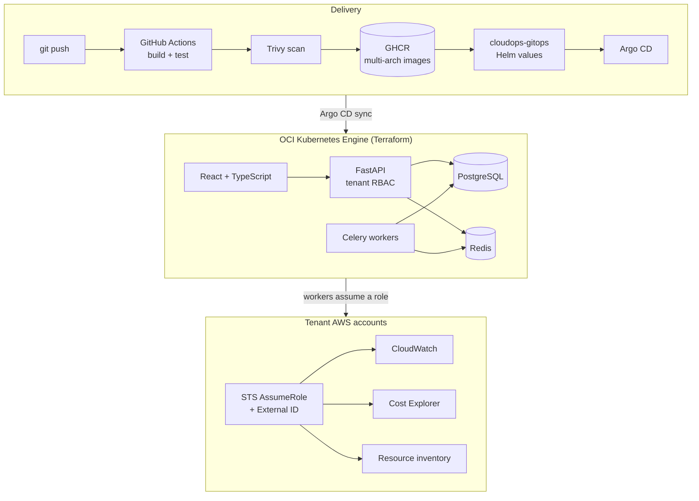

</details>

<details>
<summary><b>Validated in production</b></summary>
<br>

- PostgreSQL backup and restore
- Onboarding a brand-new user end to end
- Disconnecting an AWS account and deleting a workspace
- Cross-tenant access controls

</details>

<details>
<summary><b>Full system overview</b></summary>
<br>


</details>

## Projects

<p align="center">
  <a href="https://github.com/ridhampansara27/inbox-lookout"><picture><source media="(prefers-color-scheme: dark)" srcset="https://raw.githubusercontent.com/ridhampansara27/ridhampansara27/main/assets/card-inbox-lookout-dark.svg"><source media="(prefers-color-scheme: light)" srcset="https://raw.githubusercontent.com/ridhampansara27/ridhampansara27/main/assets/card-inbox-lookout-light.svg"></picture></a>
  <a href="https://github.com/ridhampansara27/cloudops-gitops"><picture><source media="(prefers-color-scheme: dark)" srcset="https://raw.githubusercontent.com/ridhampansara27/ridhampansara27/main/assets/card-cloudops-gitops-dark.svg"><source media="(prefers-color-scheme: light)" srcset="https://raw.githubusercontent.com/ridhampansara27/ridhampansara27/main/assets/card-cloudops-gitops-light.svg"></picture></a>
  <a href="https://github.com/ridhampansara27/cloudops-infrastructure"><picture><source media="(prefers-color-scheme: dark)" srcset="https://raw.githubusercontent.com/ridhampansara27/ridhampansara27/main/assets/card-cloudops-infrastructure-dark.svg"><source media="(prefers-color-scheme: light)" srcset="https://raw.githubusercontent.com/ridhampansara27/ridhampansara27/main/assets/card-cloudops-infrastructure-light.svg"></picture></a>
  <a href="https://github.com/ridhampansara27/aws-ecs-terraform-task-manager"><picture><source media="(prefers-color-scheme: dark)" srcset="https://raw.githubusercontent.com/ridhampansara27/ridhampansara27/main/assets/card-aws-ecs-terraform-task-manager-dark.svg"><source media="(prefers-color-scheme: light)" srcset="https://raw.githubusercontent.com/ridhampansara27/ridhampansara27/main/assets/card-aws-ecs-terraform-task-manager-light.svg"></picture></a>
  <a href="https://github.com/ridhampansara27/binance-trading-agent"><picture><source media="(prefers-color-scheme: dark)" srcset="https://raw.githubusercontent.com/ridhampansara27/ridhampansara27/main/assets/card-binance-trading-agent-dark.svg"><source media="(prefers-color-scheme: light)" srcset="https://raw.githubusercontent.com/ridhampansara27/ridhampansara27/main/assets/card-binance-trading-agent-light.svg"></picture></a>
  <a href="https://www.ridham-pansara-portfolio.online/"><picture><source media="(prefers-color-scheme: dark)" srcset="https://raw.githubusercontent.com/ridhampansara27/ridhampansara27/main/assets/card-portfolio-dark.svg"><source media="(prefers-color-scheme: light)" srcset="https://raw.githubusercontent.com/ridhampansara27/ridhampansara27/main/assets/card-portfolio-light.svg"></picture></a>
</p>

## Stack

<p align="center">
  <a href="https://skillicons.dev">
    <picture>
      <source media="(prefers-color-scheme: dark)" srcset="https://skillicons.dev/icons?i=aws%2Cazure%2Cgcp%2Cterraform%2Cdocker%2Ckubernetes%2Cgithubactions%2Cgitlab%2Cjenkins%2Clinux%2Cbash%2Cgit%2Cpy%2Cts%2Cfastapi%2Creact%2Cpostgres%2Credis%2Cprometheus%2Cgrafana&perline=10&theme=dark">
      <source media="(prefers-color-scheme: light)" srcset="https://skillicons.dev/icons?i=aws%2Cazure%2Cgcp%2Cterraform%2Cdocker%2Ckubernetes%2Cgithubactions%2Cgitlab%2Cjenkins%2Clinux%2Cbash%2Cgit%2Cpy%2Cts%2Cfastapi%2Creact%2Cpostgres%2Credis%2Cprometheus%2Cgrafana&perline=10&theme=light">
      
    </picture>
  </a>
</p>

<details>
<summary><code>$ cat stack.yaml</code></summary>

```yaml
cloud:           [AWS, Oracle Cloud (OCI), Azure, GCP]
aws:             [EC2, S3, CloudFront, Route 53, IAM, VPC, CloudWatch, Lambda, ECS, STS, Cost Explorer]
infra_as_code:   [Terraform]
containers:      [Docker, Kubernetes, OKE, Helm]
delivery:        [GitHub Actions, GitLab CI/CD, Jenkins, Argo CD, GHCR]
security:        [Trivy image scanning, STS AssumeRole + External ID, RBAC, tenant isolation]
observability:   [Prometheus, Grafana, CloudWatch]
application:     [Python, TypeScript, FastAPI, React, PostgreSQL, Redis, Celery]
systems:         [Linux, Bash, eBPF/XDP, STM32, LoRa]
```

</details>

## Activity

<p align="center">
  <picture>
    <source media="(prefers-color-scheme: dark)" srcset="https://raw.githubusercontent.com/ridhampansara27/ridhampansara27/output/stats-dark.svg">
    <source media="(prefers-color-scheme: light)" srcset="https://raw.githubusercontent.com/ridhampansara27/ridhampansara27/output/stats-light.svg">
    
  </picture>
  <picture>
    <source media="(prefers-color-scheme: dark)" srcset="https://raw.githubusercontent.com/ridhampansara27/ridhampansara27/output/top-langs-dark.svg">
    <source media="(prefers-color-scheme: light)" srcset="https://raw.githubusercontent.com/ridhampansara27/ridhampansara27/output/top-langs-light.svg">
    
  </picture>
</p>

<picture>
  <source media="(prefers-color-scheme: dark)" srcset="https://raw.githubusercontent.com/ridhampansara27/ridhampansara27/output/snake-dark.svg">
  <source media="(prefers-color-scheme: light)" srcset="https://raw.githubusercontent.com/ridhampansara27/ridhampansara27/output/snake-light.svg">
  
</picture>

## Contact

> [!TIP]
> I'm looking for a **master's thesis, internship or working-student role** in cloud infrastructure, DevOps, platform engineering or cloud security. If your team works on Kubernetes, infrastructure as code or FinOps, I'd like to hear about it.

**M.Sc. Computer Engineering for IoT Systems**, Hochschule Nordhausen, Germany<br>
**B.E. Computer Engineering**, Gujarat Technological University, India

<a href="https://www.linkedin.com/in/ridhampansara27/"></a>
<a href="https://www.ridham-pansara-portfolio.online/"></a>

<sub>The animated graphics here are generated by <code>scripts/build_assets.py</code>; stats and the snake are rebuilt daily by a GitHub Actions workflow.</sub>
